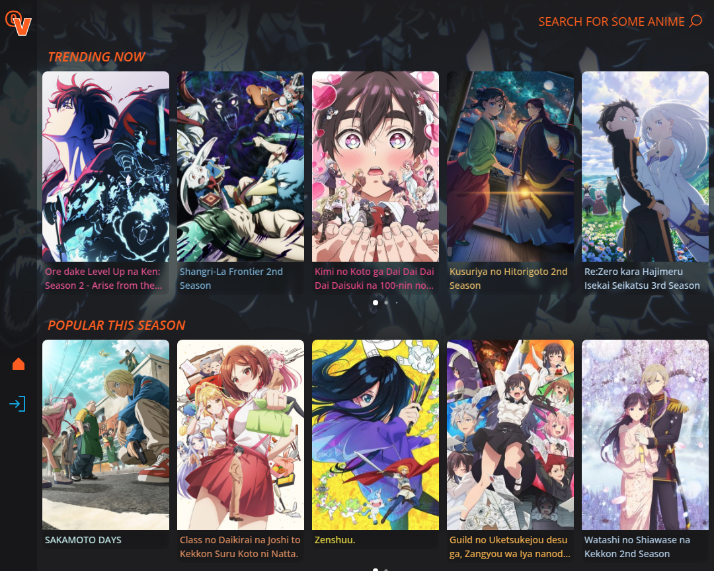
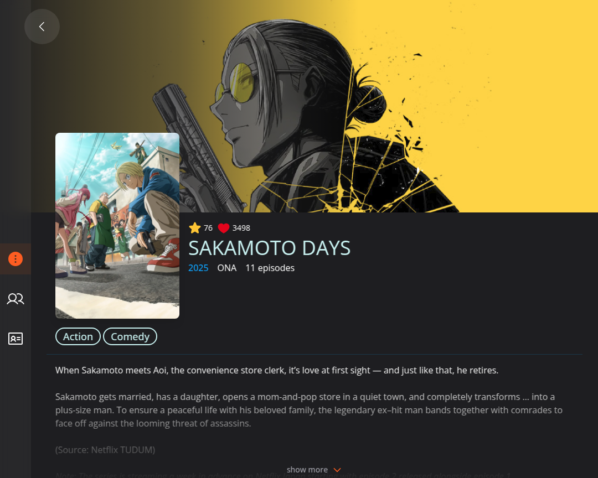
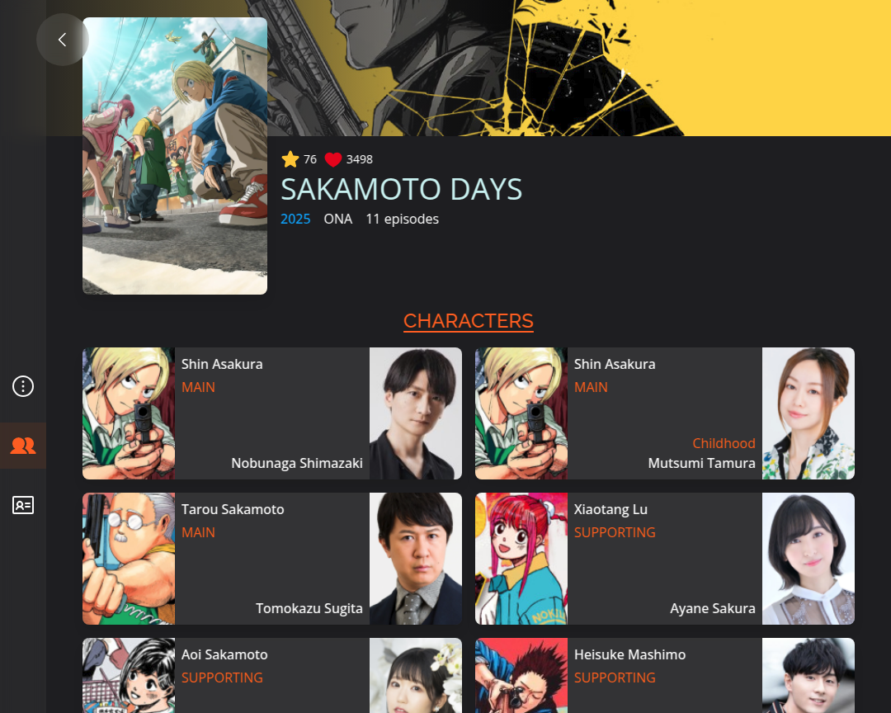
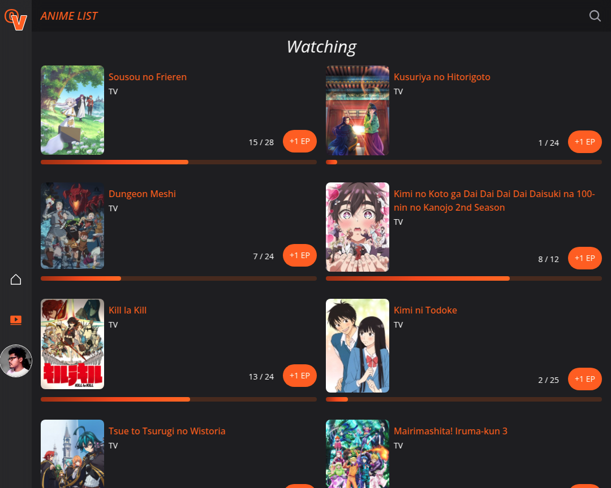
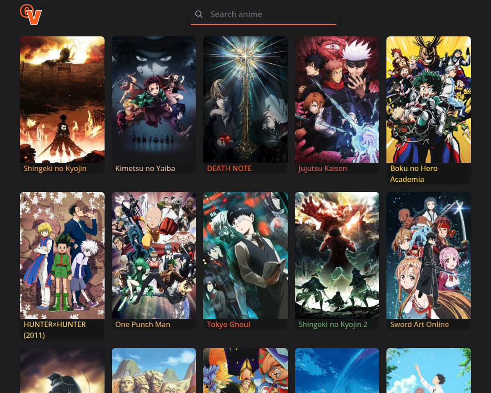

<h1 align="center">
  
</h1>

Site de animes e mangás com uma vasta biblioteca de títulos e informações sobre eles. O objetivo deste projeto é fornecer aos usuários um local centralizado para encontrar informações sobre animes e mangás de forma rápida e fácil.

## 🛠 Tecnologias Utilizadas

- **React 19** com **React Router 8**
- **TypeScript**
- **Tailwind CSS**
- **GraphQL** ([AniList API](https://docs.anilist.co/)) com **TanStack Query** e **GraphQL Codegen**
- **Vite 8** e **Vitest**

## 🚀 Acesse o Projeto

Você pode acessar o projeto online através do seguinte link:

[**Clique aqui para acessar**](https://otakuverissimo.vercel.app/).

## 💻 Rodando localmente

Requisitos: Node 26 (definido em `.nvmrc`) e Yarn 1.

```bash
nvm use
yarn install
cp .env.example .env.local   # preencha VITE_ID_CLIENT
yarn dev                     # http://localhost:9000
```

O login usa o fluxo OAuth implícito da AniList. Para testá-lo localmente, crie um client em
[anilist.co/settings/developer](https://anilist.co/settings/developer) com a redirect URL
`http://localhost:9000` e use o ID dele em `VITE_ID_CLIENT`. As páginas públicas funcionam sem login.

| Script                | O que faz                                            |
| --------------------- | ---------------------------------------------------- |
| `yarn dev`            | servidor de desenvolvimento                          |
| `yarn lint`           | ESLint                                               |
| `yarn test`           | testes com Vitest                                    |
| `yarn format`         | formata o código com Prettier                        |
| `yarn build`          | checagem de tipos (`tsc`) e build de produção        |
| `yarn preview`        | serve o build localmente                             |
| `yarn codegen`        | gera os tipos das queries em `src/gql/`              |
| `yarn codegen:schema` | atualiza `schema.graphql` com a API atual da AniList |

Mais detalhes em [`docs/architecture.md`](docs/architecture.md) e nas decisões em [`docs/adr/`](docs/adr/).

Variáveis `VITE_*` são embutidas no bundle e ficam visíveis no navegador. Nunca coloque segredos nelas.

## 📸 Capturas de Tela

Aqui estão algumas capturas de tela do projeto em funcionamento:











---

Feito com 💙 por [francisverissimo](https://francissportfolio.vercel.app/)
